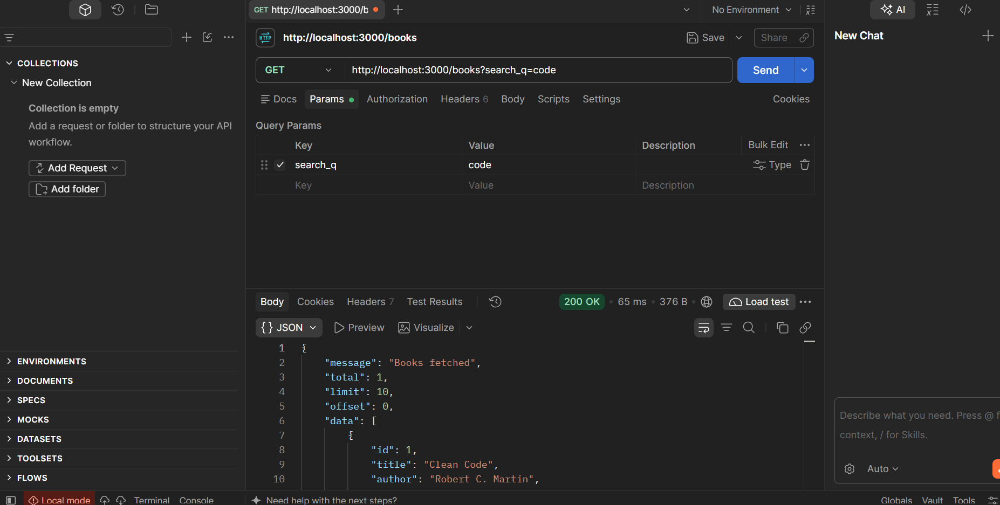
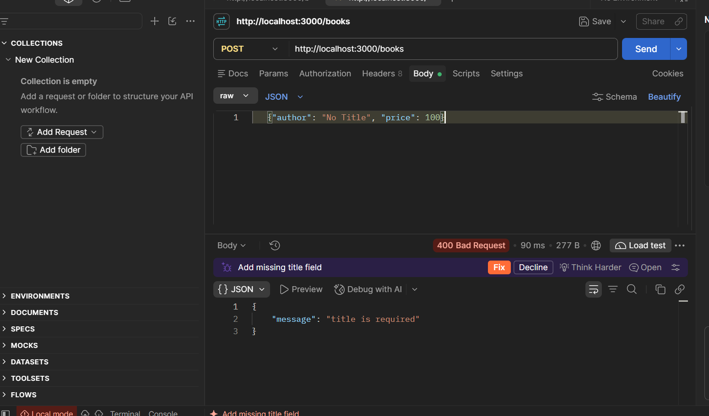
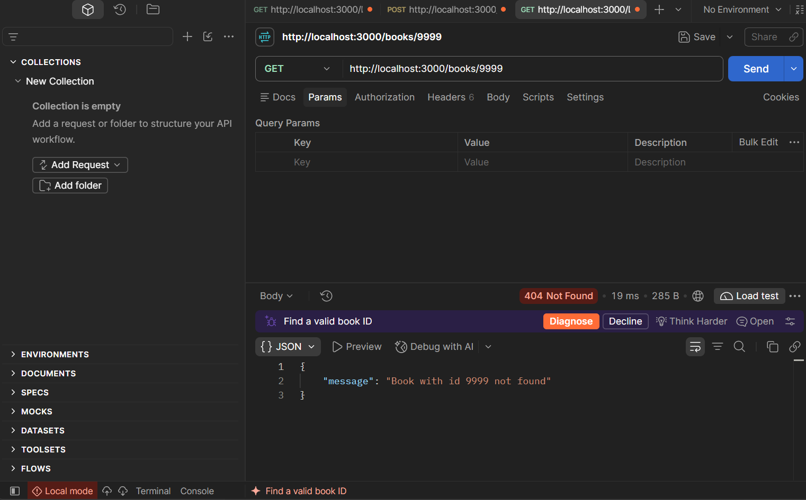
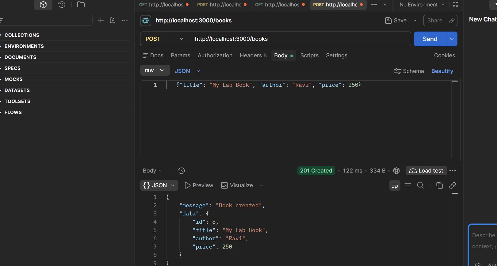
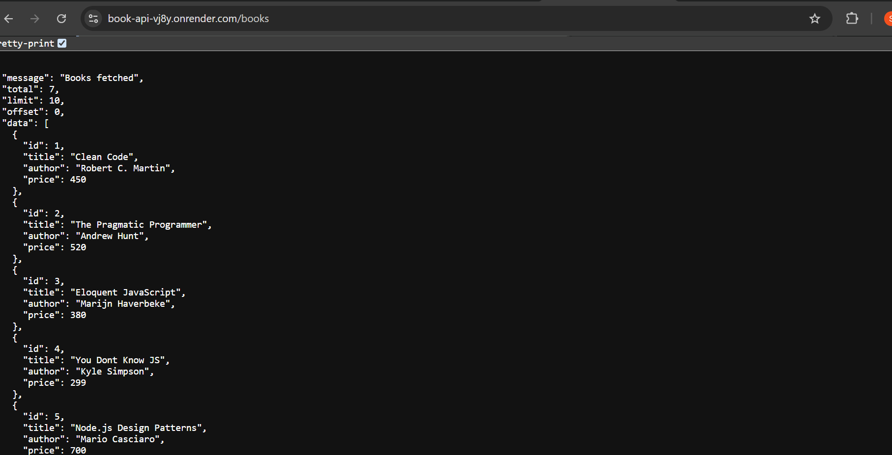

# Book API – BDF Lab 3 (REST API, query parameters, validation, debugging)

A RESTful Books API built with **Node.js, Express and SQLite**. It supports search, sorting,
pagination, price filtering, input validation and correct HTTP status codes.

**Live URL:** https://book-api-vj8y.onrender.com/books replace after deploying -->

> Render's free tier can sleep after inactivity; the first request may take ~30–50 seconds.

## Tech stack
Node.js · Express · SQLite (`sqlite3` + `sqlite`) · Postman for testing

## Run locally
```bash
npm install
cp .env.example .env     # Windows: copy .env.example .env
npm start                # http://localhost:3000
```

## Endpoints
| Method | Endpoint      | Action            | Success | Failure |
|--------|---------------|-------------------|---------|---------|
| GET    | `/books`      | List (with query params) | 200 | 400 |
| GET    | `/books/:id`  | Get one book      | 200 | 400, 404 |
| POST   | `/books`      | Create a book     | 201 | 400 |
| PUT    | `/books/:id`  | Update a book     | 200 | 400, 404 |
| DELETE | `/books/:id`  | Delete a book     | 200 | 400, 404 |

### Query parameters for `GET /books`
| Param       | Default | Description |
|-------------|---------|-------------|
| `search_q`  | (none)  | Partial title match (`LIKE %q%`) |
| `order_by`  | `id`    | `id`, `title`, `author` or `price` |
| `order`     | `ASC`   | `ASC` or `DESC` |
| `limit`     | `10`    | 1–100 |
| `offset`    | `0`     | Rows to skip |
| `min_price` | (none)  | Minimum price |
| `max_price` | (none)  | Maximum price (with `min_price` uses `BETWEEN`) |

Example: `GET /books?search_q=code&min_price=300&max_price=600&order_by=price&order=DESC&limit=5`

### Response format
Success: `{ "message": "...", "data": ... }`  
Error: `{ "message": "clear error description" }`

## Validation rules (POST / PUT)
- `title` and `author` must be non-empty strings
- `price` must be a number ≥ 0
- Any violation returns **400** with a JSON message

## Security notes
- All SQL uses **parameterised queries** (`?`); `order_by` is checked against a whitelist.
- `.env` and `node_modules` are in `.gitignore` and are not committed.

## Postman test list
Import `postman/book-api.postman_collection.json` (set variable `baseUrl`).

| # | Test | Expected |
|---|------|----------|
| 1 | GET /books (defaults) | 200 |
| 2 | GET /books?search_q=code | 200 |
| 3 | GET /books?order_by=price&order=DESC | 200 |
| 4 | GET /books?limit=2&offset=2 | 200 |
| 5 | GET /books?min_price=300&max_price=500 | 200 |
| 6 | GET /books/1 | 200 |
| 7 | POST valid book | 201 |
| 8 | PUT /books/1 valid body | 200 |
| 9 | DELETE /books/7 | 200 |
| 10 | POST missing title | 400 |
| 11 | POST missing author | 400 |
| 12 | POST price = "abc" | 400 |
| 13 | GET invalid order_by | 400 |
| 14 | GET limit=abc | 400 |
| 15 | GET min_price > max_price | 400 |
| 16 | GET /books/9999 | 404 |
| 17 | PUT /books/9999 | 404 |
| 18 | DELETE /books/9999 | 404 |
| 19 | PUT with empty title | 400 |
| 20 | GET /authors (unknown route) | 404 |

### Screenshots
<!-- Add your screenshots to the screenshots/ folder and keep the names below -->







## Debugging exercise
Four bugs were fixed in the faculty's broken project:

| Error | Cause | Fix |
|-------|-------|-----|
| `EADDRINUSE` | Port already used by another process | Stop the old process (or change `PORT`); added a friendly error in `server.on('error')` |
| `Cannot find module` | Wrong import path (e.g. `./route/books` instead of `./routes/books`) | Corrected the relative path |
| `SQLITE_ERROR: no such table: book` | Table-name typo (`book` vs `books`) | Used the correct table name `books` |
| Empty/`{}` response, `Promise {<pending>}` | Missing `await` on `db.get/all/run` | Added `await` inside an `async` handler |

## Viva answers
- **Query vs path parameter:** Path parameter identifies a specific resource (`/books/5`); query parameters filter, sort or paginate a collection (`/books?order=DESC`).
- **Stateless:** Each request carries everything the server needs; the server stores no client session between requests.
- **400 vs 404:** 400 Bad Request for invalid input; 404 Not Found when the id/resource does not exist.
